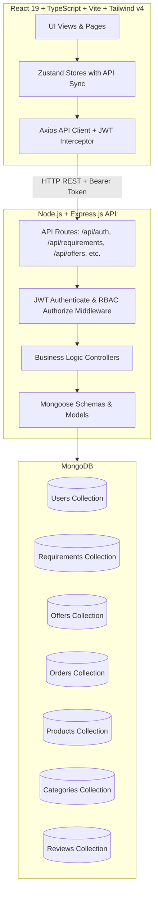

# ⚡ Reversely — Reverse & Traditional Multi-Vendor Marketplace (MERN Stack)

<div align="center">


[](https://react.dev/)
[](https://www.typescriptlang.org/)
[](https://nodejs.org/)
[](https://expressjs.com/)
[](https://www.mongodb.com/)
[](https://tailwindcss.com/)
[](https://vitejs.dev/)
[](LICENSE)

**A high-performance, full-stack hybrid reverse multi-vendor marketplace where buyers post requirements and verified suppliers compete with tailored bids.**

*Tagline: Don't search. Let vendors come to you.*

[Live Demo](#-getting-started) • [Core Concept](#-the-reverse-marketplace-concept) • [Role Workflows](#-role-based-workflows) • [Full-Stack Architecture](#️-architecture--tech-stack) • [API Documentation](#-api-endpoint-reference) • [Deployment](#-deployment-guide)

</div>

---

## 📖 Table of Contents

- [Overview & Objectives](#-overview)
- [The Reverse Marketplace Concept](#-the-reverse-marketplace-concept)
- [Key Features](#-key-features)
- [Role-Based Workflows](#-role-based-workflows)
  - [👤 Customer Experience](#1--customer-experience)
  - [🏢 Vendor Experience](#2--vendor-experience)
  - [🛡️ Admin Oversight](#3-️-admin-oversight)
- [Architecture & Tech Stack](#-architecture--tech-stack)
  - [Full-Stack Architecture Diagram](#full-stack-architecture-diagram)
  - [Directory Structure](#directory-structure)
  - [Database Schemas & Mongoose Models](#database-schemas--mongoose-models)
- [Getting Started (Local Development)](#-getting-started)
  - [Prerequisites](#prerequisites)
  - [Environment Variables](#environment-variables)
  - [Database Seeding](#database-seeding)
  - [Running Frontend & Backend](#running-the-application)
- [API Endpoint Reference](#-api-endpoint-reference)
- [Testing & Quality Assurance](#-testing--quality-assurance)
- [Deployment Guide (Render / Node.js + Vercel)](#-deployment-guide)
- [Design System & Aesthetics](#-design-system--aesthetics)
- [Limitations & Future Roadmap](#-limitations--future-roadmap)
- [License](#-license)

---

## 🌟 Overview

In traditional e-commerce, customers spend countless hours browsing rigid catalogs, comparing disparate sellers, and negotiating custom quotes offline.

**REVERSELY** flips procurement and commerce on its head with a **Reverse RFP (Request for Proposal) Engine**:
1. Customers define *what* they need, *quantity*, *specifications*, *budget range*, and *deadline*.
2. Verified vendors discover these requirements as business opportunities and submit tailored, competitive bids.
3. Customers compare bids side-by-side using an intelligent match score matrix and accept the best quotation with one click.
4. The system automatically creates an order with a **visual 6-stage lifecycle tracker**.
5. Simultaneously, Reversely preserves standard direct-to-consumer browsing for off-the-shelf catalog products.

---

## 🔄 The Reverse Marketplace Concept

```
┌─────────────────────────┐
│   1. CUSTOMER POSTS     │ ──> Title, Category, Quantity, Budget Range,
│      REQUIREMENT        │     Delivery Location, Deadline & Custom Specs
└───────────┬─────────────┘
            │
            ▼
┌─────────────────────────┐
│   2. VENDORS DISCOVER   │ ──> Filter opportunities by category, budget & match score;
│      OPPORTUNITIES      │     Analyze project specs & customer timeline
└───────────┬─────────────┘
            │
            ▼
┌─────────────────────────┐
│   3. VENDORS SUBMIT     │ ──> Quote tailored pricing, delivery estimate,
│      COMPETITIVE QUOTES │     warranty & included value-add services
└───────────┬─────────────┘
            │
            ▼
┌─────────────────────────┐
│   4. COMPARE & ACCEPT   │ ──> Side-by-side matrix comparison with Best Value,
│      OFFERS             │     Fastest Delivery, and Top Rated algorithmic badges
└───────────┬─────────────┘
            │
            ▼
┌─────────────────────────┐
│   5. 6-STAGE ORDER      │ ──> Requirement Accepted ➔ Confirmed ➔ Processing ➔
│      LIFECYCLE TRACKING │     Packed ➔ Shipped ➔ Delivered
└─────────────────────────┘
```

---

## ✨ Key Features

### 🎯 Reverse Commerce Engine
- **4-Step Requirement Wizard**: Intuitive step-by-step form (General Info → Quantity & Budget → Delivery & Timeline → Technical Specifications) with real-time sticky summary sidebar.
- **Dynamic Quotation Builder**: Vendors formulate competitive bids with instant visual feedback against the customer's target budget.
- **Side-by-Side Offer Comparison**: Compare multiple bids simultaneously across total price, warranty, delivery speed, trust score, and included services.
- **One-Click Atomic Acceptance**: Accepting an offer marks competing offers as rejected, updates the requirement to `fulfilled`, and generates an `Order`.

### 📦 6-Stage Visual Order Stepper
- `requirement_accepted` ➔ `confirmed` ➔ `processing` ➔ `packed` ➔ `shipped` ➔ `delivered`.
- Authorized vendors can advance fulfillment stages with real-time persistence in MongoDB.

### 🛡️ Role-Based Access Control (RBAC)
- Strict separation of customer, vendor, and admin capabilities.
- Public registration restricts administrative creation.

---

## 👥 Role-Based Workflows

### 1. 👤 Customer Experience
- **Post RFP Requirements**: Fill in specifications, budget ranges, and required delivery dates.
- **Manage Active Inquiries**: Monitor quotation counts and vendor engagement in real-time.
- **Compare & Accept**: Evaluate proposals side-by-side and accept the optimal bid.
- **Track Orders**: Follow shipment and delivery milestones.
- **Review Suppliers**: Rate delivered orders.

### 2. 🏢 Vendor Experience
- **Opportunity Discovery**: Filter open RFP requirements by category, location, and budget.
- **Bid Submission**: Submit competitive quotes with delivery guarantees and warranty terms.
- **Catalog Management**: Add, update, and manage off-the-shelf product listings.
- **Fulfillment Stepper**: Advance order stages as production and shipping progress.

### 3. 🛡️ Admin Oversight
- **System Metrics**: Real-time Gross Merchandise Value (GMV), user counts, and platform activity.
- **User Moderation**: Verify vendor credentials and toggle verified badge status.
- **Order Audit**: Inspect complete order histories, audit logs, and delivery statuses.

---

## 🏗️ Architecture & Tech Stack

### Full-Stack Architecture Diagram



### Directory Structure

```
Full-stack/
├── backend/                       # Express.js & MongoDB Backend
│   ├── server.js                  # Server entrypoint with graceful shutdown
│   ├── package.json               # Backend dependencies & scripts
│   ├── .env.example               # Template environment variables
│   ├── src/
│   │   ├── app.js                 # Express app configuration & middleware
│   │   ├── config/
│   │   │   └── database.js        # Mongoose connection & error listeners
│   │   ├── models/
│   │   │   ├── User.js            # User model with bcrypt password hashing
│   │   │   ├── Category.js        # Product & RFP categories
│   │   │   ├── Requirement.js     # Reverse RFP customer requirements
│   │   │   ├── Offer.js           # Vendor quotations & badges
│   │   │   ├── Order.js           # Orders with 6-stage timeline
│   │   │   ├── Product.js         # Direct ecommerce catalog products
│   │   │   └── Review.js          # Delivered order reviews
│   │   ├── middleware/
│   │   │   ├── authenticate.js    # JWT Bearer token validation
│   │   │   ├── authorize.js       # Role-based access control (RBAC)
│   │   │   └── errorHandler.js    # Centralized error handler
│   │   ├── controllers/           # Endpoint business logic
│   │   │   ├── authController.js
│   │   │   ├── requirementsController.js
│   │   │   ├── offersController.js
│   │   │   ├── ordersController.js
│   │   │   ├── productsController.js
│   │   │   ├── categoriesController.js
│   │   │   ├── reviewsController.js
│   │   └── seed/
│   │       ├── seed.js            # Idempotent database seeder
│   │       └── seedData.json      # Structured JSON seed records
│   └── tests/                     # Automated Jest test suites
│       ├── auth.test.js           # Auth & security tests
│       ├── marketplace.test.js    # Complete end-to-end flow test
│       └── mockDb.js              # In-memory test driver
├── src/                           # Frontend (React 19 + TypeScript)
│   ├── components/                # UI, Layout, Shared domain components
│   ├── pages/                     # Public, Auth, Customer, Vendor, Admin
│   ├── services/api/              # Abstracted Axios API client
│   ├── stores/                    # Zustand persistent stores with API sync
│   └── types/                     # TypeScript domain interfaces
├── index.html                     # HTML5 root with SEO meta tags
├── vite.config.ts                 # Vite bundler config with /api proxy
├── package.json                   # Root package & orchestration scripts
└── README.md                      # Comprehensive project documentation
```

### Database Schemas & Mongoose Models

1. **User**: `name`, `email` (unique), `passwordHash`, `role` (`customer` | `vendor` | `admin`), `companyName`, `avatar`, `verified`, `location`, `isActive`.
2. **Requirement**: `customId` (`REQ-xxxx`), `customerId`, `customerName`, `title`, `category`, `description`, `quantity`, `unit`, `minBudget`, `maxBudget`, `location`, `deadline`, `status` (`open` | `closed` | `fulfilled` | `cancelled`), `offersCount`, `specifications`.
3. **Offer**: `customId` (`OFF-xxxx`), `requirementId`, `vendorId`, `vendorName`, `vendorRating`, `vendorTrustScore`, `price`, `deliveryDays`, `warranty`, `includedServices`, `matchScore`, `badges`, `status` (`pending` | `accepted` | `rejected`).
4. **Order**: `customId` (`ORD-xxxx`), `requirementId`, `offerId`, `customerId`, `vendorId`, `title`, `totalAmount`, `status` (`requirement_accepted` | `confirmed` | `processing` | `packed` | `shipped` | `delivered`), `expectedDelivery`, `timeline`.
5. **Product**: `customId` (`PRD-xxxx`), `vendorId`, `title`, `category`, `price`, `stock`, `rating`, `imageUrl`, `description`, `isActive`.
6. **Category**: `name`, `slug` (unique), `description`, `isActive`.
7. **Review**: `orderId` (unique), `customerId`, `vendorId`, `rating` (1-5), `comment`.

---

## 🚀 Getting Started

### Prerequisites

Ensure you have installed:
- **Node.js**: v18.0.0 or higher (v20+ recommended)
- **npm**: v9.0.0 or higher
- **MongoDB**: MongoDB Atlas cluster URI or local MongoDB daemon running on `mongodb://127.0.0.1:27017`

### Environment Variables

#### Backend Configuration (`backend/.env`):
Create `backend/.env` based on `backend/.env.example`:
```env
PORT=5000
NODE_ENV=development
MONGODB_URI=mongodb://127.0.0.1:27017/reversely
JWT_SECRET=your_jwt_secret_key_reversely_2026
CLIENT_URL=http://localhost:5173
```

#### Frontend Configuration (`.env.local` or environment):
```env
VITE_API_BASE_URL=http://localhost:5000/api
```
*(Leave empty to automatically use relative `/api` via Vite dev proxy).*

### Database Seeding

To populate MongoDB with initial demo accounts, categories, requirements, offers, products, and orders:
```bash
# From workspace root:
npm run server:seed

# Or from backend directory:
cd backend
npm run seed
```

### Running the Application

In development, start the backend and frontend:

1. **Terminal 1: Start Backend API**
   ```bash
   npm run server:dev
   # Runs on http://localhost:5000
   # Health check at http://localhost:5000/api/health
   ```

2. **Terminal 2: Start Frontend**
   ```bash
   npm run dev
   # Runs on http://localhost:5173
   ```

---

## 🔑 Demo Accounts & Authentication

The login screen (`/login`) includes **1-Click Instant Demo Login Cards**:

| Role | Email | Password | Persona / Company | Capabilities |
|---|---|---|---|---|
| **Customer** | `customer@example.com` | `password123` | Saad Ahmed (Apex Innovations) | Post requirements, compare offers, accept bids, track orders |
| **Vendor** | `vendor@example.com` | `password123` | PrintHub Solutions | Bid on RFPs, manage catalog, advance fulfillment stages |
| **Vendor 2** | `vendor2@example.com` | `password123` | TechCraft Enterprises | Compete on RFPs, view assigned orders |
| **Admin** | `admin@example.com` | `password123` | Admin Supervisor | Global stats, user verification, order monitoring |

---

## 📡 API Endpoint Reference

### Authentication
- `POST /api/auth/register` - Register a customer or vendor (admin registration forbidden).
- `POST /api/auth/login` - Login with email and password, returns JWT token.
- `POST /api/auth/demo-login` - 1-Click developer demo login.
- `GET /api/auth/me` - Get current authenticated user profile (`Bearer <token>`).

### Requirements (Reverse Marketplace RFPs)
- `GET /api/requirements` - List requirements (supports `search`, `category`, `status`, `customerId`).
- `GET /api/requirements/:id` - Get requirement details with live offer counts.
- `POST /api/requirements` - Post a new requirement (*Customer only*).
- `PATCH /api/requirements/:id/status` - Update requirement status (*Owner or Admin*).
- `DELETE /api/requirements/:id` - Cancel requirement (*Owner or Admin*).

### Offers (Vendor Quotations)
- `GET /api/requirements/:id/offers` - Get all quotations submitted for a requirement.
- `POST /api/requirements/:id/offers` - Submit a quotation (*Vendor only*).
- `GET /api/offers` - List vendor's own offers or all offers (*Vendor/Admin*).
- `GET /api/offers/:id` - Get specific quotation details.
- `POST /api/offers/:id/accept` - **Accept an offer**: atomically marks offer as `accepted`, rejects competing bids, sets requirement to `fulfilled`, and creates an `Order` (*Customer owner only*).

### Orders & Tracking
- `GET /api/orders` - Role-filtered orders list (customers see purchases, vendors see assigned jobs).
- `GET /api/orders/:id` - View order details and 6-stage timeline stepper.
- `PATCH /api/orders/:id/status` - Advance order lifecycle stage (*Assigned Vendor or Admin*).

### Products (Direct Catalog)
- `GET /api/products` - List products with search and category filtering.
- `GET /api/products/:id` - Single product details.
- `POST /api/products` - Create new product listing (*Vendor only*).
- `PATCH /api/products/:id` - Edit product listing (*Owner Vendor only*).
- `DELETE /api/products/:id` - Remove product (*Owner Vendor only*).

### Categories & Reviews
- `GET /api/categories` - List active marketplace categories.
- `GET /api/reviews/vendor/:id` - Get vendor reviews.
- `POST /api/reviews/order/:id` - Submit review for completed/delivered order (*Customer only*).

### Admin Oversight
- `GET /api/admin/stats` - Platform aggregated statistics (GMV, user counts, order counts).
- `GET /api/admin/users` - Search and filter users by role and verification status.
- `PATCH /api/admin/users/:id/verify` - Toggle user verified badge.

### Health Check
- `GET /api/health` - Service status, database connection state, and uptime.

---

## 🧪 Testing & Quality Assurance

The backend includes comprehensive automated integration test suites executed with Jest:
```bash
# Run tests from workspace root:
npm run test:backend

# Or from backend directory:
cd backend
npm test
```

### Verified Scenarios:
- ✅ Customer and vendor registration, password hashing with bcrypt, duplicate email rejection.
- ✅ Unauthorized public admin creation prevention.
- ✅ JWT Bearer token authentication and `/api/auth/me` profile retrieval.
- ✅ The complete essential integration scenario:
  1. Customer posts requirement for 100 T-shirts (Budget ₹30,000).
  2. Vendor A submits offer (₹27,500, 4 days).
  3. Vendor B submits offer (₹25,900, 6 days).
  4. Customer compares both bids and accepts Vendor A.
  5. Backend atomically creates Order linked to Vendor A, marks requirement as fulfilled, and marks Vendor B's bid as rejected.
  6. Double acceptance prevention enforced with HTTP 400.
  7. Vendor A advances order through `processing` ➔ `delivered`.
  8. Customer reviews delivered order.
  9. Health endpoint verifies healthy status.

---

## 🚢 Deployment Guide

### Backend Deployment (Render / Railway / DigitalOcean)
1. Push repository to GitHub.
2. In your cloud provider (e.g. Render), create a new **Web Service**:
   - **Root Directory**: `backend`
   - **Build Command**: `npm install`
   - **Start Command**: `npm start`
3. Configure Environment Variables:
   - `NODE_ENV`: `production`
   - `PORT`: `5000` (or provider's default `$PORT`)
   - `MONGODB_URI`: Your MongoDB Atlas connection string (`mongodb+srv://...`)
   - `JWT_SECRET`: Secure random secret key
   - `CLIENT_URL`: Your deployed frontend URL (e.g. `https://reversely-marketplace.vercel.app`)
4. Verify backend health endpoint:
   ```bash
   curl https://your-backend-service.onrender.com/api/health
   ```

### Vercel Frontend Configuration
1. Open your Vercel project dashboard for `Reverely-marketplace`.
2. Under **Settings ➔ Environment Variables**, add:
   - `VITE_API_BASE_URL`: `https://your-backend-service.onrender.com/api`
3. Trigger a redeployment.
4. The deployed frontend will now make live API requests to your cloud backend with real MongoDB persistence.

---

## 🎨 Design System & Aesthetics

Reversely is styled with a distinct, premium **Dark Tech SaaS** visual language:

- **Canvas & Backgrounds**: Deep Void (`#050816`), Slate Obsidian (`#0B0F19`), and Navy Charcoal (`#111827`).
- **Primary Accents**: Vivid Electric Indigo (`#5B37F5` / `#6366F1`) and Sky Cyan (`#48CBFF`).
- **Status Indicators**:
  - Emerald (`#2BD696`): Accepted offers, delivered orders, verified suppliers.
  - Amber (`#FAB505`): Pending reviews, processing orders.
  - Crimson (`#FF5677`): Rejected quotes, cancelled requirements.
- **Typography**: Space Grotesk, Instrument Serif, and Plus Jakarta Sans.
- **Interactions**: Smooth framer-motion page transitions and interactive hover micro-animations.

---

## 🗺️ Limitations & Future Roadmap

- **Escrow Payment Gateway**: Direct integration with Razorpay / Stripe for advance deposits and milestone releases.
- **Real-Time WebSockets**: Live bid notifications using Socket.io during active RFP rounds.
- **Direct Buyer-Seller Chat**: In-app encrypted messaging for specification clarifications prior to quote acceptance.

---

## 📄 License

This project is licensed under the **MIT License**. See the [LICENSE](LICENSE) file for details.

<div align="center">

Crafted with ❤️ for modern procurement and seamless multi-vendor commerce.

</div>
