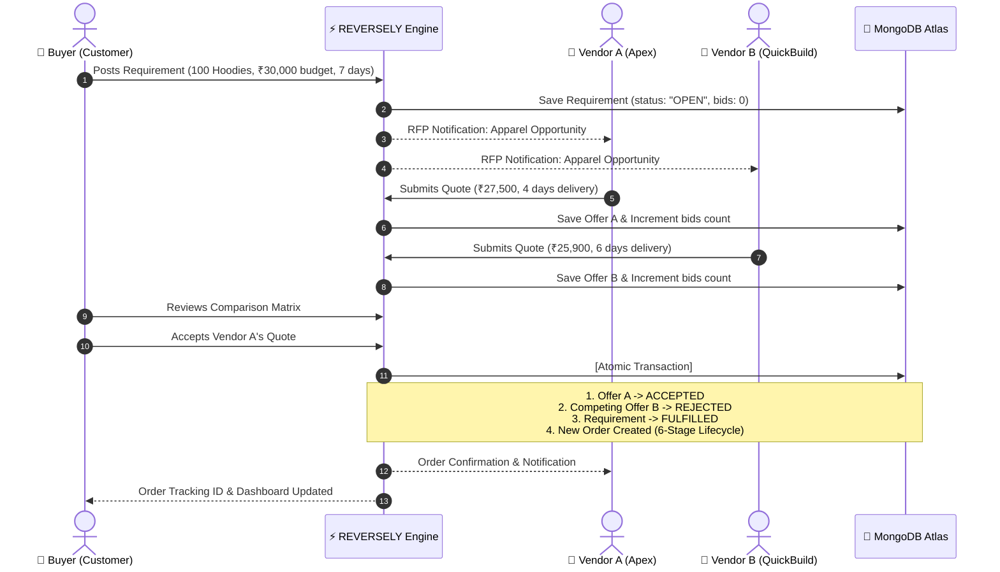

# ⚡ REVERSELY — Reverse & Traditional Multi-Vendor Marketplace (MERN Stack)

<div align="center">


[](https://reversely-marketplace.vercel.app)
[](https://reverely-marketplace.onrender.com)
[](https://reverely-marketplace.onrender.com/api/health)
[](https://www.mongodb.com/atlas)

<br/>

[](https://react.dev/)
[](https://www.typescriptlang.org/)
[](https://nodejs.org/)
[](https://expressjs.com/)
[](https://tailwindcss.com/)
[](https://vitejs.dev/)
[](LICENSE)

### **A production-ready, full-stack hybrid reverse marketplace where buyers post requests and verified vendors compete with tailored bids.**

*Tagline: "Don't search catalogs. Let suppliers compete for your business."*

---

### 🌐 **Live Cloud Deployment Links**

| Service | Host | Status | Direct Link |
| :--- | :--- | :---: | :--- |
| **Frontend Web App** | **Vercel** |  | [https://reversely-marketplace.vercel.app](https://reversely-marketplace.vercel.app) |
| **RESTful API Server** | **Render** |  | [https://reverely-marketplace.onrender.com](https://reverely-marketplace.onrender.com) |
| **API Health Status** | **Render** |  | [https://reverely-marketplace.onrender.com/api/health](https://reverely-marketplace.onrender.com/api/health) |
| **Database Cluster** | **MongoDB Atlas** |  | [MongoDB Atlas Cluster0](https://cloud.mongodb.com) |
| **Source Code** | **GitHub** |  | [saad-affan12/Reverely-marketplace](https://github.com/saad-affan12/Reverely-marketplace) |

</div>

---

## 📖 Table of Contents

- [⚡ Project Overview](#-project-overview)
- [🔄 The Reverse Marketplace Paradigm](#-the-reverse-marketplace-paradigm)
- [👥 Role-Based Workflows](#-role-based-workflows)
  - [1. Buyer / Customer](#1-buyer--customer-flow)
  - [2. Supplier / Vendor](#2-supplier--vendor-flow)
  - [3. Platform Administrator](#3-platform-administrator)
- [🔑 Demo Accounts & Credentials](#-demo-accounts--credentials)
- [🏗️ Full-Stack System Architecture](#️-full-stack-system-architecture)
- [📊 Database Models & Schemas](#-database-models--schemas)
- [💻 Terminal Database Inspection CLI](#-terminal-database-inspection-cli)
- [🚀 Local Development Setup](#-local-development-setup)
- [📡 API Endpoint Reference](#-api-endpoint-reference)
- [🧪 Testing & Quality Assurance](#-testing--quality-assurance)
- [☁️ Cloud Deployment Configuration](#️-cloud-deployment-configuration)
- [🎨 Design System & Dark Tech Aesthetics](#-design-system--dark-tech-aesthetics)
- [📄 License](#-license)

---

## ⚡ Project Overview

In traditional e-commerce, buyers waste hours scrolling through static catalogs, comparing disparate suppliers, and manually negotiating prices. 

**REVERSELY** reverses this dynamic completely with a **Smart RFP (Request for Proposal) Engine**:
1. **Buyers** publish procurement requirements with specific quantities, budget ceilings, custom specifications, and delivery deadlines.
2. **Vendors** receive real-time notifications of matching opportunities and submit binding commercial quotations with prices, delivery timetables, and warranty terms.
3. **Buyers** compare competing quotes side-by-side using an intelligent match score matrix and accept the optimal bid with a single click.
4. **Order Fulfillment** is tracked end-to-end through a transparent **6-stage lifecycle tracking pipeline**.

---

## 🔄 The Reverse Marketplace Paradigm



---

## 👥 Role-Based Workflows

### 1. Buyer / Customer Flow
- **Post Requirement**: Multi-step RFP composer specifying category, volume, budget limit, and required delivery date.
- **Quote Comparison**: Real-time side-by-side grid evaluating vendor price, delivery speed, and verified supplier trust ratings.
- **1-Click Accept**: Atomically accepts the winning quote, generates an active order, and gracefully rejects competing bids.
- **Lifecycle Tracking**: 6-stage order tracking (`Requirement Accepted` ➔ `Confirmed` ➔ `Processing` ➔ `Packed` ➔ `Shipped` ➔ `Delivered`).
- **Review Submission**: Rate vendor quality and leave verified feedback after delivery.

### 2. Supplier / Vendor Flow
- **Opportunity Discovery**: Browse real-time buyer demands filtered by category, budget threshold, and geographic location.
- **Quote Submission**: Submit granular bids including unit pricing, total cost, estimated turnaround days, and technical notes.
- **Order Advancement**: Step accepted orders forward through the 6-stage fulfillment workflow with live timestamps.
- **Trust Profile**: Gain verified badges and accumulate 5-star ratings to earn priority visibility.

### 3. Platform Administrator
- **Executive Metrics**: Live GMV (Gross Merchandise Value), active orders, platform revenue, and user analytics.
- **User Governance**: View complete user directory with 1-click verification badge management.
- **Marketplace Moderation**: Audit posted requirements, inspect vendor quotes, and view order fulfillment progress.

---

## 🔑 Demo Accounts & Credentials

The platform includes **1-click Instant Demo Login buttons** in the navbar, or you can log in manually:

| Role | Name | Email | Password | Pre-seeded Access |
| :--- | :--- | :--- | :--- | :--- |
| **Buyer** | Saad Ahmed | `customer@example.com` | `password123` | Active requirements, live quote comparisons, orders |
| **Vendor** | PrintHub Solutions | `vendor@example.com` | `password123` | Open RFPs, quote submissions, active fulfillment orders |
| **Vendor** | TechCraft Supplies | `vendor2@example.com` | `password123` | Competitive bidding and supplier profile |
| **Admin** | Admin Supervisor | `admin@example.com` | `password123` | Full dashboard, user verification, order audit controls |

*Passwords are securely hashed using **bcrypt (salt factor 10)** in MongoDB Atlas.*

---

## 🏗️ Full-Stack System Architecture

```text
┌────────────────────────────────────────────────────────────────────────┐
│                        CLIENT / FRONTEND (Vercel)                      │
│                                                                        │
│   React 19 • TypeScript 5.7 • Vite 6.1 • Tailwind CSS v4 • Zustand 5   │
│   Framer Motion • Lucide Icons • Axios Dynamic API Client              │
└────────────────────────────────────┬───────────────────────────────────┘
                                     │ HTTPS / REST (JWT Bearer Auth)
                                     ▼
┌────────────────────────────────────────────────────────────────────────┐
│                        API SERVER (Render)                             │
│                                                                        │
│   Node.js • Express 4.21 • Helmet Security • Rate Limiting • Morgan    │
│   Auth & RBAC Middleware • Controllers • Error Handling Pipeline       │
└────────────────────────────────────┬───────────────────────────────────┘
                                     │ Mongoose 8.10 (Direct ReplicaSet)
                                     ▼
┌────────────────────────────────────────────────────────────────────────┐
│                     DATABASE (MongoDB Atlas Cloud)                     │
│                                                                        │
│   AWS AP_South_1 • 3-Node Replica Set • Encrypted Storage at Rest      │
│   Collections: users, requirements, offers, orders, categories, reviews│
└────────────────────────────────────────────────────────────────────────┘
```

---

## 📊 Database Models & Schemas

| Collection | Schema Highlights | Key Relationships |
| :--- | :--- | :--- |
| **`users`** | `customId`, `name`, `email`, `passwordHash`, `role`, `companyName`, `verified`, `avatar` | Parent to requirements, offers, and orders |
| **`categories`** | `name`, `slug`, `description`, `icon`, `isActive` | Categorizes requirements and products |
| **`requirements`** | `customId`, `customerId`, `title`, `category`, `quantity`, `maxBudget`, `status`, `offersCount` | 1-to-Many with Offers; 1-to-1 with winning Order |
| **`offers`** | `customId`, `requirementId`, `vendorId`, `price`, `deliveryDays`, `status` (`pending`/`accepted`/`rejected`) | Belongs to Requirement & Vendor |
| **`orders`** | `customId`, `requirementId`, `offerId`, `customerId`, `vendorId`, `totalAmount`, `status`, `timeline[]` | Holds 6-stage lifecycle tracking items |
| **`products`** | `customId`, `vendorId`, `title`, `price`, `category`, `stock`, `badges[]` | Catalog merchandise for standard purchases |
| **`reviews`** | `orderId`, `customerId`, `vendorId`, `rating`, `comment` | Post-fulfillment verified rating |

---

## 💻 Terminal Database Inspection CLI

You can query your live **MongoDB Atlas** cluster directly from your terminal using custom built-in commands:

```powershell
# View formatted ASCII summary tables of ALL collections in Atlas:
npm run db:all

# View all live registered Customers, Vendors, and Admins:
npm run db:users

# View all posted Buyer Requirements:
npm run db:reqs

# View all Vendor Bids and Quotations:
npm run db:offers

# View all active and fulfilled Orders:
npm run db:orders
```

---

## 🚀 Local Development Setup

### 1. Prerequisites
- **Node.js** v18+ installed
- **Git** installed
- **MongoDB Atlas** account (or local MongoDB on port 27017)

### 2. Clone & Install Dependencies
```powershell
git clone https://github.com/saad-affan12/Reverely-marketplace.git
cd Reverely-marketplace

# Install frontend dependencies
npm install

# Install backend dependencies
npm --prefix backend install
```

### 3. Configure Environment Variables

**Backend (`backend/.env`):**
```env
PORT=5000
NODE_ENV=development
MONGODB_URI=your_mongodb_atlas_connection_string
JWT_SECRET=super_secret_reversely_jwt_key_2026_dev
CLIENT_URL=http://localhost:5173
```

**Frontend (`.env` or `.env.local` - optional for dev):**
```env
# Leave empty in local dev: Vite automatically proxies /api to http://localhost:5000
VITE_API_BASE_URL=
```

### 4. Seed the Database
Populates MongoDB Atlas with 7 categories, 4 demo users, 7 requirements, 6 offers, 2 orders, and 8 products:
```powershell
npm run server:seed
```

### 5. Start Frontend & Backend with ONE Command
```powershell
npm run dev:all
```
- **Backend API**: `http://localhost:5000`
- **Frontend App**: `http://localhost:5173` (or `http://localhost:3001`)

---

## 📡 API Endpoint Reference

### Authentication & Profiles
| Method | Endpoint | Access | Description |
| :--- | :--- | :--- | :--- |
| `POST` | `/api/auth/register` | Public | Register customer or vendor (Admin restricted) |
| `POST` | `/api/auth/login` | Public | Authenticate and obtain JWT token |
| `POST` | `/api/auth/demo-login` | Public | Instant 1-click test login by role |
| `GET` | `/api/auth/me` | Authenticated | Retrieve current user profile |

### Requirements (Buyer RFPs)
| Method | Endpoint | Access | Description |
| :--- | :--- | :--- | :--- |
| `GET` | `/api/requirements` | Public | List requirements with search, category & status filters |
| `GET` | `/api/requirements/:id` | Public | Retrieve single requirement and metadata |
| `POST` | `/api/requirements` | Customer | Create a new procurement request |
| `PATCH` | `/api/requirements/:id/status`| Customer/Admin | Update status (`open`, `closed`, `fulfilled`) |

### Offers & Bids
| Method | Endpoint | Access | Description |
| :--- | :--- | :--- | :--- |
| `GET` | `/api/offers/requirement/:id`| Authenticated | Get all competing quotes for an RFP |
| `POST` | `/api/offers` | Vendor | Submit quote with price and delivery timetable |
| `POST` | `/api/offers/:id/accept` | Customer | **Atomically accept quote & generate order** |

### Orders & Fulfillment Tracking
| Method | Endpoint | Access | Description |
| :--- | :--- | :--- | :--- |
| `GET` | `/api/orders` | Authenticated | Get role-scoped orders for customer/vendor |
| `GET` | `/api/orders/:id` | Authenticated | Retrieve order details & 6-stage timeline |
| `PATCH` | `/api/orders/:id/status` | Vendor/Admin | Advance order stage (`confirmed` ➔ `delivered`) |

### Admin Oversight
| Method | Endpoint | Access | Description |
| :--- | :--- | :--- | :--- |
| `GET` | `/api/admin/stats` | Admin | Overall GMV, revenue, and entity counters |
| `GET` | `/api/admin/users` | Admin | Directory of all registered users with filters |
| `PATCH` | `/api/admin/users/:id/verify` | Admin | Grant or revoke verified supplier status |

### Health Check
| Method | Endpoint | Access | Description |
| :--- | :--- | :--- | :--- |
| `GET` | `/api/health` | Public | Uptime status, timestamp & service verification |

---

## 🧪 Testing & Quality Assurance

Automated integration tests validate the complete marketplace lifecycle:

```powershell
npm run test:backend
```

**Test Coverage Highlights:**
- ✅ **Authentication**: Registration validation, duplicate email prevention, admin creation restriction, JWT generation.
- ✅ **Atomic Order Acceptance**: Acceptance marks winning bid `ACCEPTED`, marks competing bids `REJECTED`, marks requirement `FULFILLED`, and generates order.
- ✅ **Double Acceptance Guard**: Rejects subsequent attempts to accept an already-fulfilled requirement with HTTP 400.
- ✅ **Fulfillment Progress**: Step-by-step advancement through `processing` ➔ `shipped` ➔ `delivered`.

---

## ☁️ Cloud Deployment Configuration

### Frontend (Vercel)
- **Framework Preset**: `Vite`
- **Root Directory**: `./`
- **Build Command**: `npm run build`
- **Output Directory**: `dist`
- **Environment Variables**:
  - `VITE_API_BASE_URL`: `https://reverely-marketplace.onrender.com`
- **SPA Rewrite Rule ([vercel.json](vercel.json))**: Configured so deep page refreshes never return 404.

### Backend (Render)
- **Runtime**: `Node.js`
- **Root Directory**: `backend`
- **Build Command**: `npm install`
- **Start Command**: `npm start`
- **Environment Variables**:
  - `NODE_ENV`: `production`
  - `MONGODB_URI`: Atlas connection string
  - `JWT_SECRET`: 64-character signing key
  - `CLIENT_URL`: `*` (or your Vercel URL)

---

## 🎨 Design System & Dark Tech Aesthetics

Reversely is engineered with a bespoke, futuristic **Dark Tech SaaS** visual language:

- **Surface Palettes**: Deep Void (`#050816`), Slate Obsidian (`#0B0F19`), and Navy Charcoal (`#111827`).
- **Accent Radiance**: Electric Indigo (`#5B37F5` / `#6366F1`) and Sky Cyan (`#48CBFF`).
- **Semantic Badges**:
  - 🟢 **Emerald (`#2BD696`)**: Fulfilled requirements, accepted bids, verified suppliers.
  - 🟡 **Amber (`#FAB505`)**: Open bids, pending quotes, in-transit orders.
  - 🔴 **Crimson (`#FF5677`)**: Rejected quotes, closed requirements.
- **Typography**: Space Grotesk, Plus Jakarta Sans, and Instrument Serif.
- **Micro-Interactions**: Framer-motion transitions, subtle glow borders, and optimistic UI updates.

---

## 📄 License

This project is licensed under the **MIT License**.

<div align="center">

**Built with precision for modern enterprise procurement and multi-vendor commerce.**

⭐ If you found this project helpful, give it a star on [GitHub](https://github.com/saad-affan12/Reverely-marketplace)!

</div>
